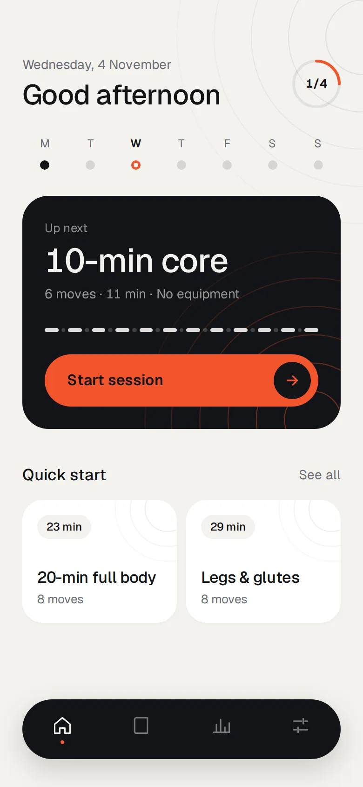
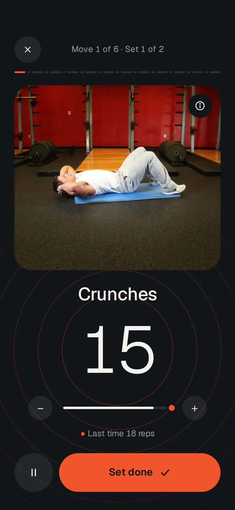
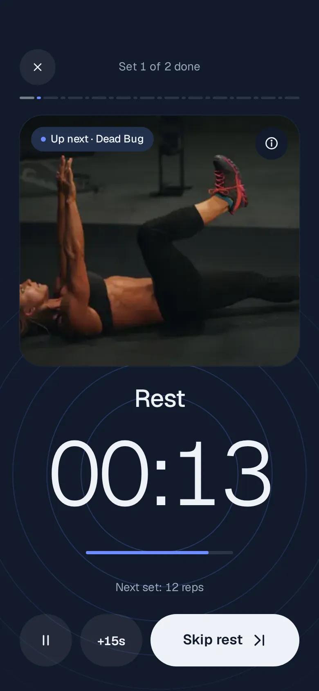
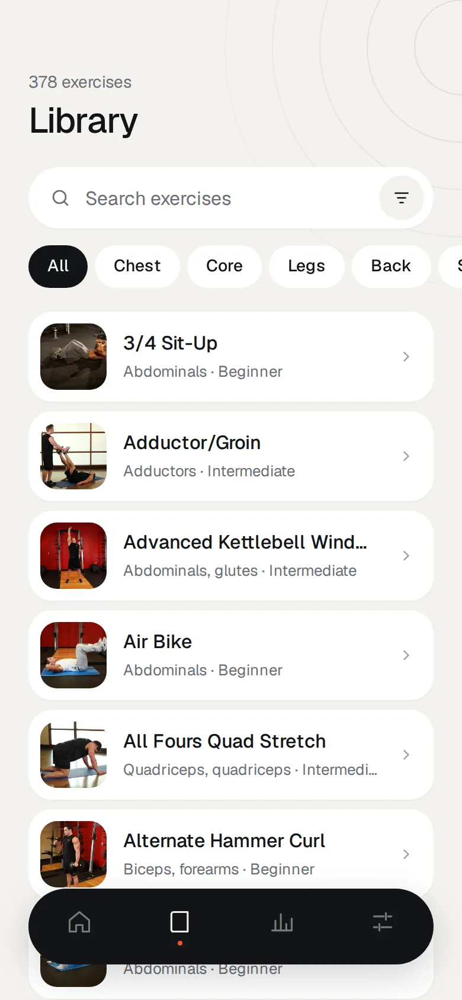
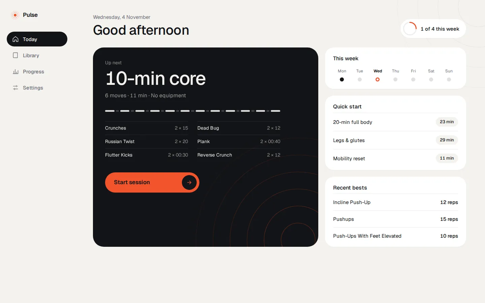
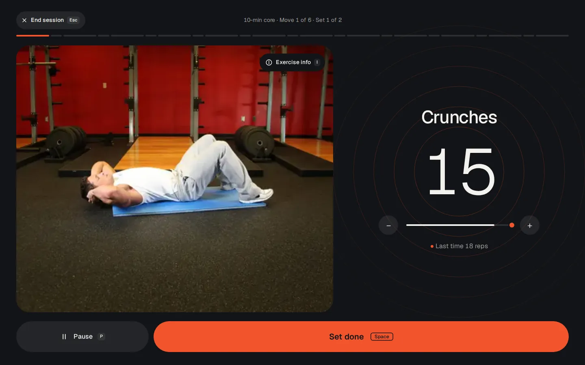
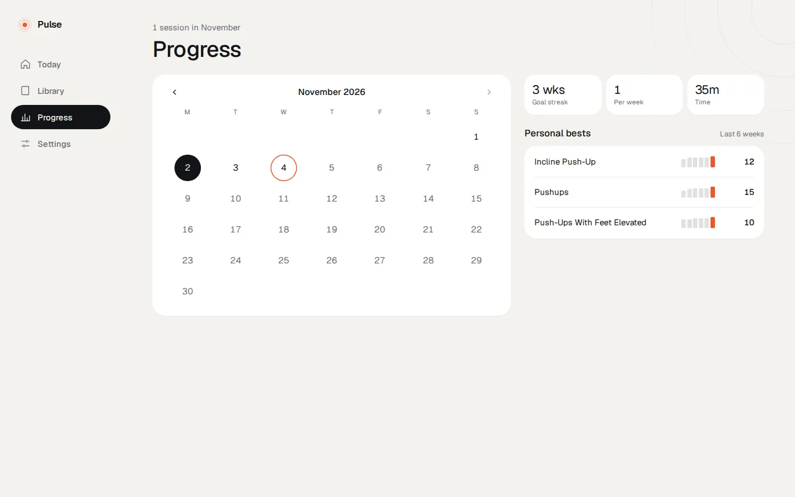

# Pulse

**Live demo: [pulse-workout-rho.vercel.app](https://pulse-workout-rho.vercel.app/)**

A local-first web app for home workouts. Pick a workout, press Start, and the player walks you
through every set and rest with a timer you can read from the floor. Your sessions, personal
bests and weekly goal stay on your device; there is no sign-up, and demo data is seeded on the
first visit so everything works straight away.

<table>
  <tr>
    <td></td>
    <td></td>
    <td></td>
    <td></td>
  </tr>
  <tr>
    <td align="center">Today</td>
    <td align="center">A set</td>
    <td align="center">Rest</td>
    <td align="center">Library</td>
  </tr>
</table>







## Features
- **Today:** the next workout, your weekly goal and quick-start workouts.
- **Player:** reps and timed holds, rests with +15 s, a 5 s "get into position" lead-in for
  holds, countdown beeps, optional voice cues and the screen kept awake. Exercise instructions
  are one tap away in the info sheet.
- **Library:** about 380 exercises from free-exercise-db with photos, filtered by muscle and
  equipment.
- **Progress:** a month calendar, goal streak, sessions per week, and personal bests with
  six-week sparklines.
- Light and dark themes, phone and desktop layouts, keyboard shortcuts in the desktop player.

## Stack
React, TypeScript, Vite, CSS Modules, React Router, Zustand, Dexie (IndexedDB) and Vitest. The
font is Geist, self-hosted via Fontsource. Exercise data and photos come from
[free-exercise-db](https://github.com/yuhonas/free-exercise-db) (Unlicense).

## Commands
```sh
npm install
npm run dev               # dev server
npm run build             # type-check and production build to dist/
npm run preview           # serve dist/
npm run test              # unit tests
npm run lint              # ESLint
npm run e2e               # Playwright: every route and player phase, phone + desktop, light + dark
npm run import:exercises  # re-import free-exercise-db into src/data/exercises.json + public/exercises/
```

## Deploy
Vercel, from `main`. `vercel.json` sets the Vite build (`npm run build` → `dist/`), rewrites every
path to `index.html` so deep links and reloads work (static files are served first), and caches the
hashed `assets/` for a year. No environment variables are needed.

## Data
Everything lives in the browser's IndexedDB. To start over, use Settings → Reset demo data. The
database is still named `field-manual` (the app's earlier name) so existing data carries over.
